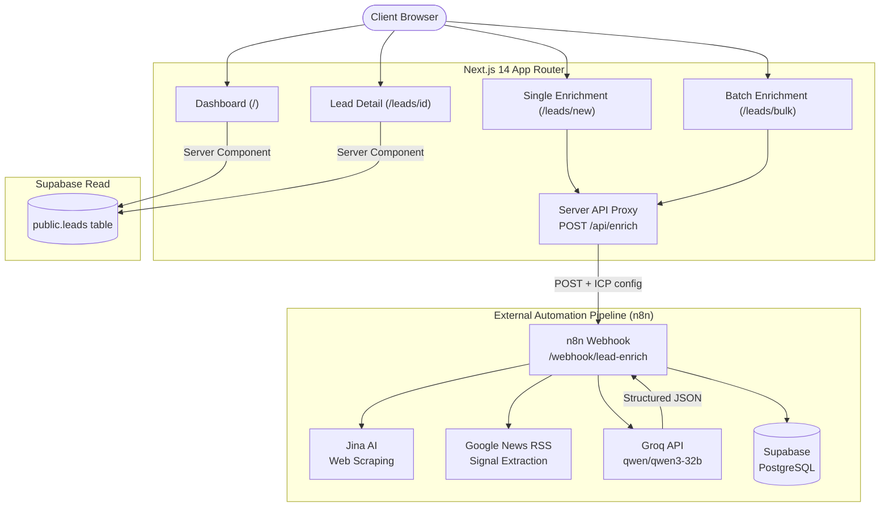

# AI Lead Intelligence

[](https://nextjs.org/)
[](https://www.typescriptlang.org/)
[](https://tailwindcss.com/)
[](https://supabase.com/)
[](https://n8n.io/)
[](https://groq.com/)
[](https://opensource.org/licenses/MIT)

> **An AI-powered B2B lead intelligence platform** — enrich any company website into a structured lead profile, score it against your Ideal Customer Profile (ICP), and surface actionable signals for sales and GTM teams.

---

## The Problem

Sales and GTM teams waste enormous time manually researching company websites, trying to determine whether a prospect is a good fit. Most tools either:

- Return generic firmographic data with no context about *your* target market
- Require manual scoring against ICP criteria
- Lack transparency about *why* a lead ranked the way it did

---

## The Solution

**AI Lead Intelligence** automates the full enrichment-to-qualification pipeline:

1. **Input** a company website URL
2. **Enrich** — an n8n automation workflow scrapes the company site (via Jina AI), fetches recent news (via Google News RSS), and detects technology signals
3. **Score** — Groq (`qwen/qwen3-32b`) runs structured ICP analysis against your defined criteria and produces a weighted score with a category-level breakdown
4. **Store** — enriched lead data lands in Supabase PostgreSQL
5. **Review** — the Next.js dashboard surfaces all leads with search, filtering, sorting, and export tools

No black-box scores. Every point is explained.

---

## Key Features

### Lead Intelligence Dashboard (`/`)
- **Stats Cards**: Live counts for Total Leads, High Fit (>= 80), Medium Fit (60-79), and Low Fit (< 60)
- **Search**: Full-text search across company name, domain, and industry
- **Filters & Sorting**: Filter by fit tier or industry; sort by newest or highest score
- **Export**: Download filtered lead data as **CSV** or **JSON** with one click

### Single Lead Enrichment (`/leads/new`)
- **URL Input**: Automatically normalises URLs to `https://` format
- **Duplicate Pre-check**: Detects previously enriched domains via `GET /api/enrich?checkDomain=` and surfaces an option to view or re-enrich
- **ICP Multi-Select**: Define target Industries, Company Sizes, Locations, Business Models, and Technologies before enriching
- **Stage-based Progress UI**: Five labelled stages — *Collecting company information*, *Analyzing technology signals*, *Analyzing company data with AI*, *Calculating ICP fit*, *Saving enriched lead*
- **Result Preview**: Inline score card with fit badge and direct link to full lead profile

### Batch CSV Enrichment (`/leads/bulk`)
- **CSV Upload**: Drag-and-drop or file-picker input; auto-parses company website URLs from CSV
- **Sample CSV**: One-click sample CSV download for onboarding
- **Sequential Queue**: Processes items one at a time, calling `/api/enrich` per row to avoid overloading the pipeline
- **Controls**: Live progress bar, per-item status indicators (Pending / Processing / Completed / Failed), and Pause/Resume controls

### Lead Detail & ICP Breakdown (`/leads/[id]`)
- **Fit Badge**: Colour-coded (Emerald = High Fit, Amber = Medium Fit, Rose = Low Fit)
- **Score Breakdown Table**: Per-category scored breakdown with max weights
- **Data Sections**: Technology stack badges, products & services, growth signals, and recent news items
- **ICP Rationale**: Matched criteria, missing criteria, and AI-generated reasons

### Authentication (`/login`)
- Supabase Auth session management
- Demo Login bypass for local development without credentials configured

---

## Architecture



---

## End-to-End Workflow

```
User submits URL + ICP config
        |
        v
POST /api/enrich  (Next.js Server Route)
  - Validates input
  - Forwards to n8n webhook with 180s timeout
        |
        v
n8n Automation Pipeline
  - Jina AI scrapes company website content
  - Google News RSS fetches recent company news
  - Groq (qwen/qwen3-32b) performs structured ICP analysis
  - Writes enriched Lead JSON to Supabase public.leads
        |
        v
Next.js receives enriched Lead object
  - Displays stage-by-stage progress feedback
  - Navigates to /leads/[id] on success
        |
        v
Lead Detail Page
  - Reads from Supabase via server component
  - Renders score breakdown, signals, news, ICP rationale
```

---

## ICP Scoring Explained

Each lead is scored across **7 categories** totalling a maximum of **85 active points**. Revenue scoring (15 pts) is defined in the schema but not yet populated by the pipeline:

| Category | Max Weight | Source |
|---|---|---|
| Industry Alignment | 25 | AI classification vs. your target industries |
| Company Size Match | 20 | Detected size signals vs. your size range |
| Geography & Location | 15 | HQ location vs. your target markets |
| Revenue Data | 15 | _Not yet available — always displayed as 0 / 15_ |
| Technology Stack Match | 10 | Detected tech stack vs. your target technologies |
| Growth Signals | 10 | Hiring, funding, expansion indicators |
| Business Model Match | 5 | B2B / B2C / SaaS etc. vs. your criteria |

**Fit Tiers:**
| Tier | Score Range | Badge Colour |
|---|---|---|
| High Fit | >= 80 | Emerald |
| Medium Fit | 60 - 79 | Amber |
| Low Fit | < 60 | Rose |

Every lead includes `matched_criteria`, `missing_criteria`, and `reasons` arrays so sales reps know exactly why a score was given — no black box.

---

## Tech Stack

| Layer | Technology |
|---|---|
| Frontend Framework | Next.js 14 (App Router) |
| Language | TypeScript 5.7 |
| Styling | Tailwind CSS 3.4 |
| UI Components | Custom (Card, Badge, Button, Input) + Lucide React icons |
| Database | Supabase (PostgreSQL) |
| Auth | Supabase Auth |
| Automation Engine | n8n (self-hosted or cloud) |
| AI Model | Groq — `qwen/qwen3-32b` |
| Web Scraping | Jina AI |
| News Signals | Google News RSS |
| Fonts | Inter (Google Fonts) |

---

## Project Structure

```
ai-lead-intelligence/
├── app/
│   ├── api/
│   │   └── enrich/
│   │       └── route.ts          # Server-side proxy to n8n webhook
│   ├── directory/
│   │   └── page.tsx              # Lead directory page
│   ├── leads/
│   │   ├── new/
│   │   │   └── page.tsx          # Single lead enrichment form + progress UI
│   │   ├── bulk/
│   │   │   └── page.tsx          # Batch CSV enrichment queue
│   │   └── [id]/                 # Lead detail profile page
│   ├── login/                    # Supabase auth + demo login
│   ├── layout.tsx                # Root layout (sidebar, navbar, Google Fonts)
│   ├── page.tsx                  # Dashboard entry point
│   └── globals.css               # Global design tokens and base styles
│
├── components/
│   ├── dashboard/
│   │   ├── dashboard-client.tsx  # Search, filter, sort, export logic
│   │   ├── leads-table.tsx       # Filterable leads table
│   │   ├── stats-cards.tsx       # Fit tier summary cards
│   │   └── export-button.tsx     # CSV / JSON export
│   ├── leads/
│   │   ├── score-breakdown.tsx   # ICP score category breakdown table
│   │   ├── lead-score-badge.tsx  # Fit tier badge
│   │   └── icp-reasons.tsx       # Matched / missing criteria display
│   ├── icp/
│   │   └── multi-select.tsx      # Multi-select dropdown for ICP config
│   ├── ui/                       # Base UI primitives (Card, Badge, Button, Input)
│   ├── sidebar.tsx               # App sidebar with navigation
│   └── navbar.tsx                # Top navigation bar
│
├── lib/
│   ├── supabase/
│   │   ├── client.ts             # Browser-side Supabase client
│   │   ├── server.ts             # Server-side client + getLeads / getLeadById
│   │   └── mock-data.ts          # Development fallback data (Microsoft, Stripe, etc.)
│   ├── types/
│   │   └── lead.ts               # Lead, ICPConfig, ScoreBreakdown interfaces
│   ├── icp-options.ts            # ICP dropdown option constants
│   └── utils.ts                  # cn(), formatFitScore(), shared helpers
│
├── .env.example                  # Environment variable template
├── next.config.mjs
├── tailwind.config.ts
└── package.json
```

---

## Environment Variables

Copy `.env.example` to `.env.local` and fill in your credentials:

```env
# n8n Webhook URL
# Used exclusively in app/api/enrich/route.ts (server-side only — never exposed to browser)
N8N_WEBHOOK_URL=https://your-n8n-instance/webhook/lead-enrich

# Supabase Project URL (public — safe to include in client bundles)
NEXT_PUBLIC_SUPABASE_URL=https://your-project.supabase.co

# Supabase Anon Key (public — safe to include in client bundles)
NEXT_PUBLIC_SUPABASE_ANON_KEY=your-supabase-anon-key

# Supabase Service Role Key (SECRET — server-side only)
SUPABASE_SERVICE_ROLE_KEY=your-supabase-service-role-key
```

> **Security:** `SUPABASE_SERVICE_ROLE_KEY` and `N8N_WEBHOOK_URL` are consumed only by Next.js server routes and server components. They are never serialised into client-side JavaScript bundles.

---

## Local Setup

### Prerequisites

- **Node.js** 18 or later
- An **n8n** instance with a `lead-enrich` workflow that calls Groq
- A **Supabase** project with a `public.leads` table matching the `Lead` schema *(or skip and use built-in mock data)*
- A **Groq API key** configured inside your n8n workflow

### Steps

**1. Clone the repository**
```bash
git clone https://github.com/ashu529/ai-lead-intelligence.git
cd ai-lead-intelligence
```

**2. Install dependencies**
```bash
npm install
```

**3. Configure environment variables**
```bash
cp .env.example .env.local
# Open .env.local and fill in your Supabase and n8n values
```

**4. Start the development server**
```bash
npm run dev
```

**5. Open in browser**

Navigate to [http://localhost:3000](http://localhost:3000).

> **No credentials configured?** The app automatically falls back to built-in mock leads (Microsoft, Stripe, Acme Logistics) for UI exploration. The enrichment form requires a live n8n webhook to function.

---

## Available Scripts

```bash
npm run dev      # Start Next.js development server on port 3000
npm run build    # Compile production bundle
npm run start    # Start production server (requires npm run build first)
npm run lint     # Run ESLint checks
```

---

## Screenshots

> _Screenshots will be added after a stable deployment is configured._

| View | Description |
|---|---|
| Dashboard | Stats cards, searchable / filterable lead table, CSV & JSON export |
| Enrich Lead | URL input, ICP multi-select config, stage-by-stage progress, result card |
| Batch Enrich | CSV drag-and-drop upload, sequential queue, per-item status, pause/resume |
| Lead Detail | Score breakdown table, tech stack, growth signals, news, ICP rationale |

---

## Current Limitations

- **Revenue scoring not implemented** — the Revenue category (15 pts max) is always shown as `0 / 15 — Not available`. No data source currently populates this field.
- **Limited ICP location options** — the built-in location picker supports USA, India, UK, and Canada only.
- **n8n dependency** — lead enrichment requires a separately configured and running n8n instance. This repository is the frontend only.
- **180-second hard timeout** — the `/api/enrich` server route enforces a 180-second timeout on the n8n webhook call. Slow pipelines will return a timeout error to the user.
- **No result pagination** — the dashboard fetches all leads in a single Supabase query. Performance may degrade for large datasets (> 1,000 leads).
- **Minimal authentication** — `/login` supports Supabase Auth and a dev-mode demo bypass. Role-based access control is not implemented.

---

## Future Improvements

- [ ] Revenue data enrichment (Crunchbase, Clearbit, or LinkedIn integration)
- [ ] Expanded ICP location and industry option sets
- [ ] Pagination and infinite scroll on the leads dashboard
- [ ] Full-profile export (beyond table-visible fields)
- [ ] n8n pipeline health monitoring and webhook status indicators
- [ ] Role-based access control (admin, viewer, editor roles)
- [ ] CRM integrations (HubSpot, Salesforce)
- [ ] Side-by-side lead comparison with ICP breakdown diff
- [ ] User-defined ICP scoring weights per category
- [ ] Email digest or Slack notifications for new high-fit leads

---

## Live Demo

> _A hosted demo environment is not currently available. Follow the local setup instructions above to run the project, or reach out to discuss a walkthrough._

---

## Author

**Ashutosh Singh**

- GitHub: [@ashu529](https://github.com/ashu529)
- Repository: [github.com/ashu529/ai-lead-intelligence](https://github.com/ashu529/ai-lead-intelligence)

---

## License

This project is licensed under the [MIT License](https://opensource.org/licenses/MIT).
