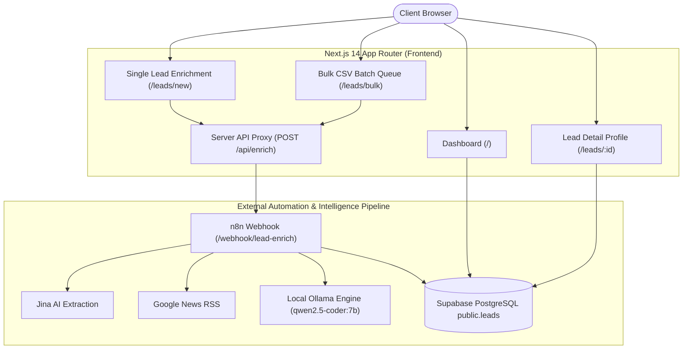

# Lead Enrichment Automation — AI Frontend

[](https://nextjs.org/)
[](https://www.typescriptlang.org/)
[](https://tailwindcss.com/)
[](https://supabase.com/)
[](https://n8n.io/)
[](https://ollama.com/)

A modern, high-performance B2B SaaS frontend built with **Next.js App Router**, **TypeScript**, **Tailwind CSS**, and **Supabase**. Communicates with an existing **n8n** automation pipeline powered by a local **Ollama Qwen 2.5 Coder 7B** AI engine for dynamic Ideal Customer Profile (ICP) lead scoring, company intelligence extraction, and signal detection.

---

## 🏗️ System Architecture



---

## 🚀 Key Features

### 1. Dynamic ICP Lead Intelligence Dashboard (`/`)
- **Real-time Metrics**: Stats cards calculating `Total Leads`, `High Fit (80-100)`, `Medium Fit (60-79)`, and `Low Fit (0-59)` directly from Supabase.
- **Directory Table**: Live search across Company Name, Domain, and Industry.
- **Filters & Sorting**: Filter by Fit Status or Industry; sort by Newest First or Highest Score.
- **Exporting & Refreshing**: Download filtered lead results to **CSV** or **JSON** formats with a single click.

### 2. Single Lead Enrichment Engine (`/leads/new`)
- **Website Input**: Automatic URL formatting (`https://`).
- **Pre-check Duplicate Notice**: Instant notification if the domain was previously enriched, offering options to view the existing lead or re-enrich.
- **ICP Multi-Select**: Custom selection for target Industries, Company Sizes, Locations, Business Models, and Technologies.
- **Honest Qwen 7B Progress UI**: Stage-based progress feedback (*"Collecting company information..."*, *"Analyzing technology signals..."*, *"Analyzing company data with AI..."*, *"Calculating ICP fit..."*, *"Saving enriched lead..."*).

### 3. Bulk CSV Batch Enrichment (`/leads/bulk`)
- **CSV Upload & Parser**: Drag-and-drop CSV importer extracting target URLs. Includes sample CSV generation.
- **Sequential Batch Queue**: Item-by-item processing calling `/api/enrich` without blocking local AI hardware resources.
- **Batch Progress Controls**: Live percentage progress bar, item status indicators (*Pending*, *Processing*, *Enriched*, *Failed*), and Pause/Resume controls.

### 4. Comprehensive Lead Details & ICP Breakdown (`/leads/[id]`)
- **Visual Fit Badge**: Score badge (Emerald, Amber, Rose) based on ICP scoring rules.
- **Category Breakdown Cards**:
  - Industry (25)
  - Company Size (20)
  - Geography (15)
  - Revenue (`0 / 15 Not available` — explicitly labeled as currently unavailable)
  - Technology (10)
  - Growth Signals (10)
  - Business Model (5)
- **Data Sections**: Detected Tech Stack badges, Products & Services tags, Growth Signals, and Recent News cards.
- **ICP Explanation**: Why this lead matches, matched criteria, and potential gaps.
- **Null Safety**: Gracefully displays `"Not available"` for missing fields without raw `null` or `undefined` strings.

### 5. Supabase Authentication (`/login`)
- Auth interface supporting Supabase Auth session management and a quick Demo Login bypass mode for unconfigured environments.

---

## ⚙️ Environment Variables Setup

Create a `.env.local` file in the project root:

```env
# Production n8n Webhook URL (Used exclusively in server route app/api/enrich/route.ts)
N8N_WEBHOOK_URL=https://consoling-clinking-cornfield.ngrok-free.dev/webhook/lead-enrich

# Supabase Server & Client Credentials
NEXT_PUBLIC_SUPABASE_URL=https://your-supabase-project.supabase.co
NEXT_PUBLIC_SUPABASE_ANON_KEY=your-supabase-anon-key
SUPABASE_SERVICE_ROLE_KEY=your-supabase-service-role-key
```

> 🔒 **Security Notice**: `SUPABASE_SERVICE_ROLE_KEY` and `N8N_WEBHOOK_URL` are strictly server-side variables and are never exposed to browser JavaScript or client components.

---

## 📦 Installation & Setup

1. **Clone the Repository & Install Dependencies**:
   ```bash
   cd d:\Project\Ai-lead-intelligence
   npm install
   ```

2. **Run Development Server**:
   ```bash
   npm run dev
   ```

3. **Open in Browser**:
   Navigate to [http://localhost:3000](http://localhost:3000).

---

## 🧪 Build & Lint Commands

```bash
# Run ESLint check
npm run lint

# Run Next.js production build
npm run build

# Start production server
npm run start
```
